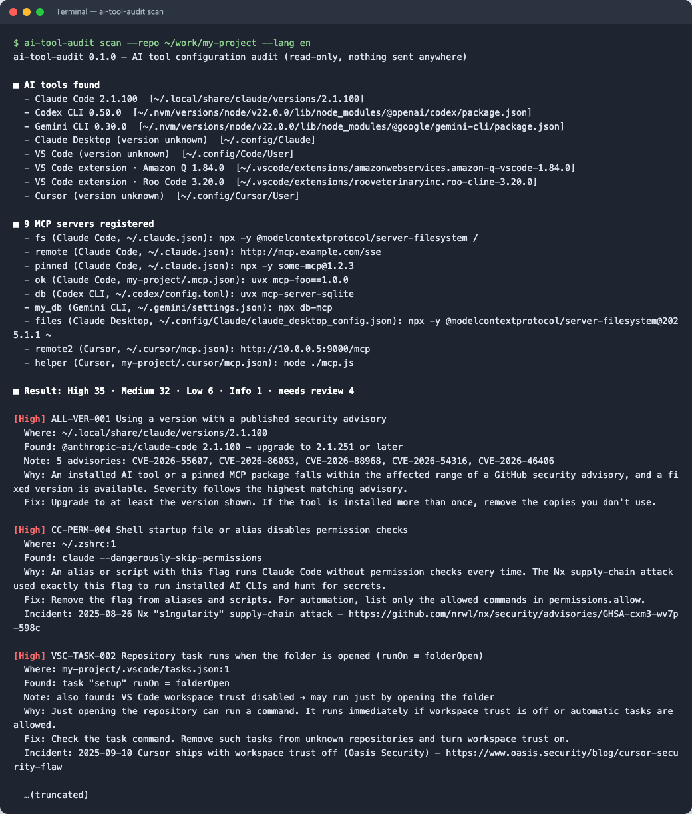
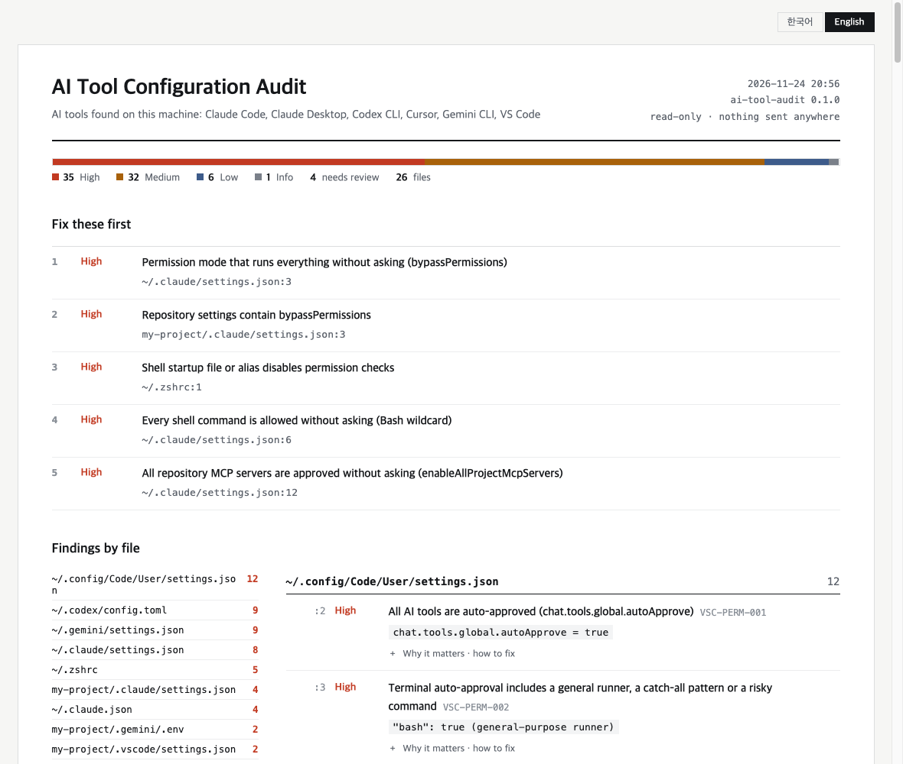
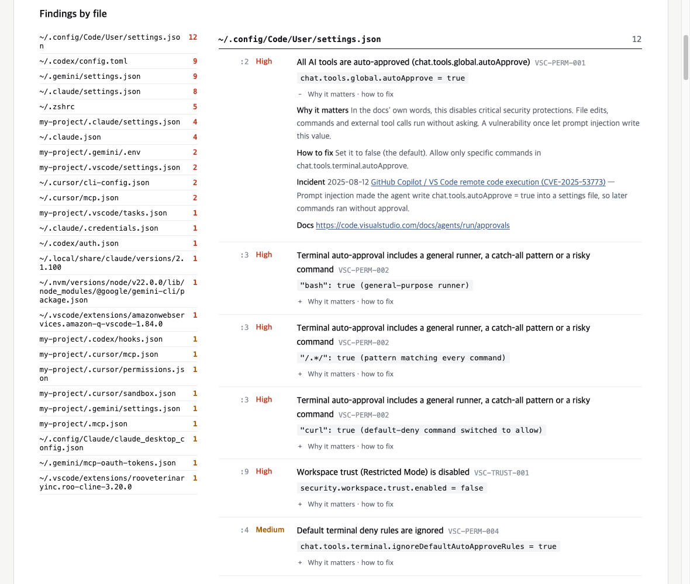
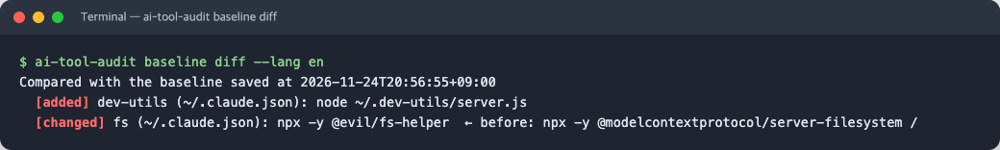

# ai-tool-audit

**A tool for security teams to audit the AI coding tools on developer machines.**

It reads — and only reads — the configuration of Claude Code, OpenAI Codex CLI, Google Gemini CLI, Claude Desktop, VS Code / Cursor (plus AI extensions) and the MCP servers registered in them, finds risky settings, and writes a report where every finding links to the public incident that makes it matter. A scan of one machine takes about a second, and uses only the Python standard library.

> ### 🔒 Built for air-gapped and restricted networks
>
> - **No network access at all.** There is no network code; no findings, settings or secrets leave the machine. Tests enforce this.
> - **One file to install.** No dependencies — copy the `.whl` from [Releases](https://github.com/prag-ai/ai-tool-audit/releases) over USB or an internal repository and install it offline.
> - **Advisory matching works offline.** Public security advisory data ships inside the tool.
> - **The HTML report makes no external requests** — no web fonts, no remote scripts.
>
> Made for banks, government and other environments where tools that phone home are not allowed.

> Output is in English or Korean. The terminal follows your system language (`--lang en` to force English). The HTML report carries both languages and opens in **your browser's language**, with a switch in the top-right corner.

[한국어](https://github.com/prag-ai/ai-tool-audit/blob/main/README.md) · [Rule list (Korean)](https://github.com/prag-ai/ai-tool-audit/blob/main/docs/규칙목록.md)



*`ai-tool-audit scan` against a deliberately misconfigured test environment. All keys are fake.*

## Developer machines are now the way in

Some of the best-known breaches of recent years did not start at a customer-facing website. They started on an engineer's machine, or with a token that machine held.

| When | Organization | What happened |
|---|---|---|
| 2022 (disclosed Feb 2023) | **LastPass** | A keylogger on a senior DevOps engineer's home computer captured the master password to the corporate vault. The attacker used the keys inside to reach the cloud storage holding customer vault backups. |
| Jan 2023 | **CircleCI** | Info-stealing malware on an engineer's laptop stole a 2FA-backed SSO session. The attacker then took customers' environment variables, tokens and keys, and CircleCI told every customer to rotate their secrets. |
| Aug 2025 | **Salesloft Drift → Salesforce customers** | Stolen OAuth tokens of an AI chat integration were used to pull data from many companies' Salesforce instances, specifically to harvest more credentials such as AWS keys and Snowflake tokens. |
| Sep 2025 | **npm ecosystem (Shai-Hulud)** | A self-replicating worm compromised more than 500 packages (CISA) and scanned developer environments for credentials and tokens. |
| Nov 2025 | **Anthropic report (GTG-1002)** | A state-sponsored group used Claude Code to attempt intrusions into about thirty organizations. Anthropic estimates AI performed 80–90% of the work. |
| Oct 2026 | **Binance** | The initial disclosure pointed to a compromised DevOps engineer's laptop; the follow-up investigation said an internal AI tool was abused to spread to other engineers' environments. |

And the AI coding tools on those machines have become a target of their own:

- **Nx "s1ngularity" (Aug 2025):** a malicious package ran the locally installed Claude Code, Gemini CLI and Amazon Q CLI with **permission checks disabled** to hunt for secrets.
- **Amazon Q Developer extension 1.84.0 (Jul 2025):** a release shipped with a prompt telling the agent to wipe files and cloud resources.
- **Malicious `@bitwarden/cli` 2026.4.0 (Apr 2026):** collected **AI and MCP config files** such as `~/.claude.json` at install time. Plaintext tokens in those files are the prize.
- **SANDWORM_MODE npm worm (Feb 2026):** **silently added malicious MCP servers** to AI tool configs.
- Claude Code, Codex, Cursor, Gemini CLI and VS Code have all had flaws where **repository-provided config** ran commands on the machine of whoever opened the repo.

## Why we built it

A security team today struggles to answer a simple question:

> "Which AI coding tools are on our developers' machines, how many of them run every command without asking, and how many keep tokens in plaintext config files?"

Three things make it hard:

1. **Too many tools, scattered settings.** Each tool uses its own locations, formats (JSON, JSONC, TOML) and key names, layered across user, project and managed settings.
2. **The same setting means different things in different versions,** and some versions carry published vulnerabilities.
3. **Existing security tools don't look here.** Antivirus and EDR watch executables and behavior; secret scanners watch repositories. Nothing looked at *how the AI tools are configured.*

ai-tool-audit answers that question for one machine at a time, and explains every finding with the real incident behind it, so developers understand why the fix matters.

## Who uses it, and where

| Who | Where |
|---|---|
| **Corporate security teams** | Deploy via MDM (Intune, Jamf, …), run `scan --json` on developer machines and aggregate: how many machines auto-approve every command, how many keep tokens in plaintext config. Re-run after a supply-chain incident hits the news, and quarterly with `baseline` to catch unregistered MCP servers. `--enterprise` checks whether each tool's managed policy is actually in place. |
| **Engineering leads / platform teams** | Check new-hire machines, audit team repositories' AI and auto-run config with `scan --repo`, and gate risky config changes in CI with `scan --repo . --fail-on high`. |
| **Individual developers** | Run `scan --html report.html` on your own machine, and run `scan --repo <path>` **before opening someone else's repository** — repo-provided hooks, MCP servers and `folderOpen` tasks can run the moment an editor opens it. |
| **Security consultants** | A standard check for client development environments. No data leaves the client machine. |

## How it differs

We surveyed public open-source tools as of 2026-11-24 ([survey notes, Korean](https://github.com/prag-ai/ai-tool-audit/blob/main/docs/research/03_landscape_license_incidents.md)). Within that survey we found no tool that does all three of the following:

| | Existing MCP scanners (Snyk Agent Scan, guardmcp, mcp-audit, …) | ai-tool-audit |
|---|---|---|
| Scope | Mostly MCP server config and tool descriptions | **Permission, auto-approval, trust, hook and auto-run settings** of six AI tools, plus MCP servers |
| Installed version vs. public advisories | No | Yes, offline |
| Data leaving the machine | Snyk Agent Scan, the most widely used, sends tool descriptions and config to a remote analysis API | None — there is no network code |
| Report | English | English and Korean (picked by browser language), every finding linked to a dated incident |

## What it checks

| Area | Examples |
|---|---|
| Permissions & auto-approval | `bypassPermissions`, aliases with `--dangerously-skip-permissions` / `--yolo`, Codex `approval_policy = "never"` / `danger-full-access`, VS Code `chat.tools.global.autoApprove`, Gemini unrestricted `run_shell_command` |
| Auto-execution | Claude Code and Gemini hooks, `apiKeyHelper`-style commands, `runOn: folderOpen` tasks, workspace trust disabled |
| MCP servers | Inline secrets, unpinned `npx` / `uvx`, plain `http://`, filesystem servers exposing the whole home directory, servers shipped by a repository, per-server auto-approval (`trust: true`) |
| Secrets | API keys in config and shell startup files (by key name and by token format: GitHub, Anthropic, OpenAI, AWS, …), credential file permissions |
| Versions | Installed Claude Code / Codex / Gemini CLI and pinned MCP packages matched **offline** against the GitHub Advisory Database |
| Drift | MCP servers added or changed since a saved baseline |

72 rules. Each rule explains why it matters and how to fix it, with dated links to the source incident.

## Principles

- **Read-only.** It never modifies or deletes your files.
- **No network.** There is no network code. Advisory data ships with the tool.
- **No subprocesses.** It does not even call `claude --version`; versions come from install folders. MCP servers are never started.
- **No secrets in output.** Only the first four characters and the location are shown. Home paths are replaced with `~`.
- **Not read:** chat/session logs, shell history, project source code.
- **Only confirmed claims.** Rules not confirmed by official documentation are reported separately as "needs review", not as risks.

These are enforced by tests: fake secrets must not appear in any output, the scanned tree must be unchanged afterwards, and a scan must complete with sockets and subprocesses blocked.

## Install

Python 3.11+. The scanner uses only the standard library.

```bash
uv tool install ai-tool-audit
# or
pipx install ai-tool-audit
```

| Where | Link |
|---|---|
| PyPI | https://pypi.org/project/ai-tool-audit/ |
| Official MCP Registry | `io.github.prag-ai/ai-tool-audit` |
| Glama | https://glama.ai/mcp/servers/prag-ai/ai-tool-audit |
| GitHub Releases (wheel, SHA-256) | https://github.com/prag-ai/ai-tool-audit/releases |

### Offline / air-gapped install

1. On a connected machine, download `ai_tool_audit-<version>-py3-none-any.whl` from [Releases](https://github.com/prag-ai/ai-tool-audit/releases) and check its SHA-256 against the release notes.
2. Move it to the target machine (USB, internal artifact store).
3. Install without network access (Python 3.11+ required on the target):

```bash
python3 -m pip install --no-index ai_tool_audit-0.2.1-py3-none-any.whl
ai-tool-audit scan --html report.html
```

## Usage

```bash
ai-tool-audit files                          # list the files it would read (opens nothing)
ai-tool-audit scan                           # audit this machine
ai-tool-audit scan --repo ~/work/my-project  # include repository-level config
ai-tool-audit scan --html report.html --md report.md --json result.json
ai-tool-audit scan --fail-on high            # exit 1 if any high-severity finding
ai-tool-audit scan --lang en                 # force English output
ai-tool-audit scan --enterprise              # also check managed-policy rules
ai-tool-audit baseline save | diff           # MCP server drift
ai-tool-audit rules [RULE-ID]                # rule list / details
```

### Use it from your AI tool (MCP server)

Connect it to Claude Code, Cursor, Codex and the like as an MCP server, then just ask **"audit my AI tool settings"** in chat — the assistant runs the scan, explains the findings and helps you fix them right there.

The MCP server follows the same rules as the scanner: it runs locally over stdio, makes no network calls and needs no extra packages, so it works on air-gapped machines too.

```bash
# after installing as above
claude mcp add ai-tool-audit -- ai-tool-audit mcp      # Claude Code
codex mcp add ai-tool-audit -- ai-tool-audit mcp       # Codex CLI
```

For tools configured through a JSON file (Cursor, Claude Desktop, VS Code):

```json
{
  "mcpServers": {
    "ai-tool-audit": { "command": "ai-tool-audit", "args": ["mcp"] }
  }
}
```

| MCP tool | What it does |
|---|---|
| `scan` | Audits this machine (and the repositories you name). Secrets show only their first 4 characters. |
| `explain_rule` | Explains a rule: why it matters, how to fix it, related incidents. Omit the ID to list all rules. |
| `list_files` | Lists the files a scan would read, without opening them. |
| `baseline_diff` | Finds MCP servers added or changed since the saved baseline. |
| `baseline_save` | Saves the current MCP servers as the baseline. The only tool that writes a file. |

## Screenshots

All screenshots come from a deliberately misconfigured **test environment** (fake keys). Regenerate them with `scripts/demo_screens.py`.

**HTML report — summary.** Severity mix and the five things to fix first.



**HTML report — findings by file.** Fixes happen one file at a time, so findings are grouped by file, with line numbers like an editor gutter. Expand a finding to see why it matters, how to fix it, and the incident behind it.



MCP drift detection (`baseline diff`): a server silently added and another one swapped.



## Limitations

- Settings that never reach a file (session-only `/yolo`, server-side team policies) are out of reach.
- Settings whose storage location is undocumented (e.g. Cursor run modes) are not checked.
- Advisory data is as of the release date. Matching Cursor's own advisories is planned for the next release.
- Incident notes and rule texts were written in Korean first and translated; please open an issue if a translation reads wrong.
- Supports macOS and Linux. Full Windows support is planned for the next release.

## References

- LastPass: [SecurityWeek](https://www.securityweek.com/lastpass-says-devops-engineer-home-computer-hacked/) · CircleCI: [incident report](https://circleci.com/blog/jan-4-2023-incident-report) · Salesloft Drift: [Google Threat Intelligence](https://cloud.google.com/blog/topics/threat-intelligence/data-theft-salesforce-instances-via-salesloft-drift)
- Shai-Hulud: [CISA alert (2025-09-23)](https://www.cisa.gov/news-events/alerts/2025/09/23/widespread-supply-chain-compromise-impacting-npm-ecosystem) · GTG-1002: [Anthropic](https://www.anthropic.com/news/disrupting-AI-espionage) · Binance: [follow-up investigation](https://www.binance.com/en/blog/community/3229153443759566763)
- Nx: [GHSA-cxm3-wv7p-598c](https://github.com/nrwl/nx/security/advisories/GHSA-cxm3-wv7p-598c) · Amazon Q: [AWS-2025-015](https://aws.amazon.com/security/security-bulletins/AWS-2025-015/) · `@bitwarden/cli`: [JFrog](https://research.jfrog.com/post/bitwarden-cli-hijack/) · SANDWORM_MODE: [Endor Labs](https://endorlabs.com/learn/sandworm-mode-dissecting-a-multi-stage-npm-supply-chain-attack)

## Enterprise rollout & training

We help companies audit developer machines at scale, set AI coding tool policies, and train security and engineering teams.

- Email: [macro@prag-ai.com](mailto:macro@prag-ai.com)
- By [prag-ai](https://github.com/prag-ai)

## License

[Apache-2.0](https://github.com/prag-ai/ai-tool-audit/blob/main/LICENSE). Bundled advisory data comes from the GitHub Advisory Database (CC-BY 4.0); see [THIRD_PARTY_NOTICES](https://github.com/prag-ai/ai-tool-audit/blob/main/THIRD_PARTY_NOTICES).
