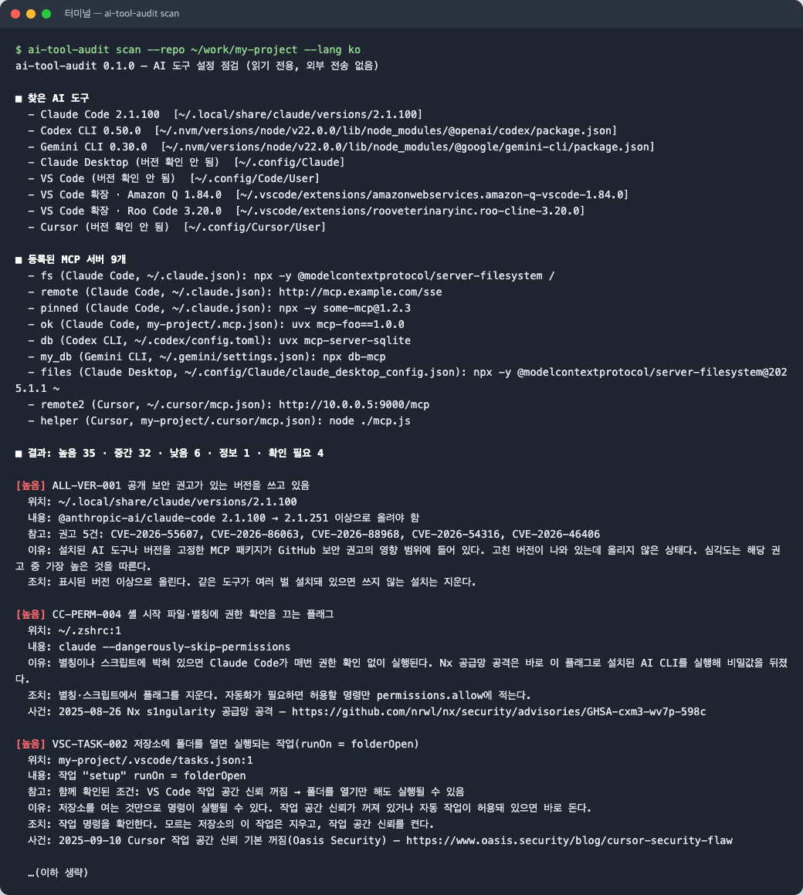
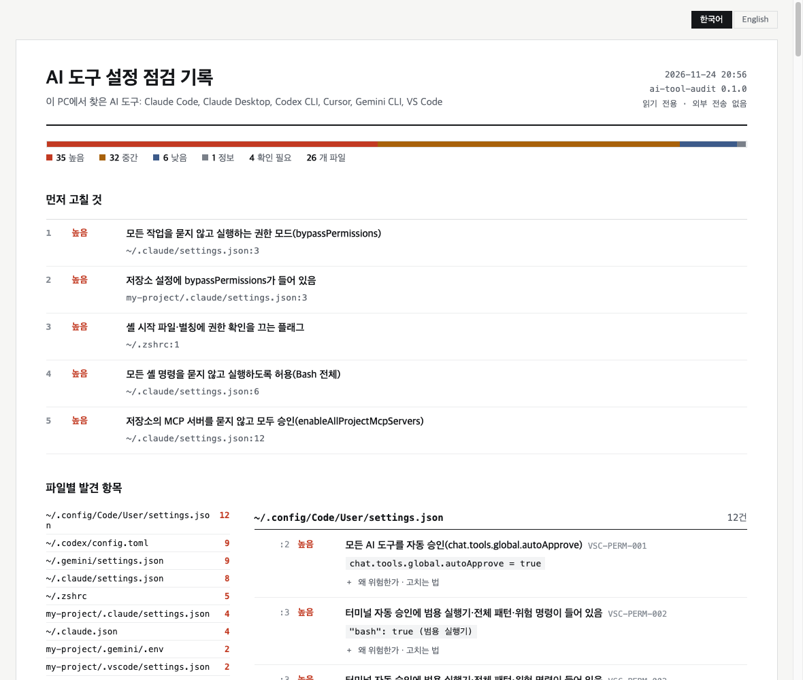
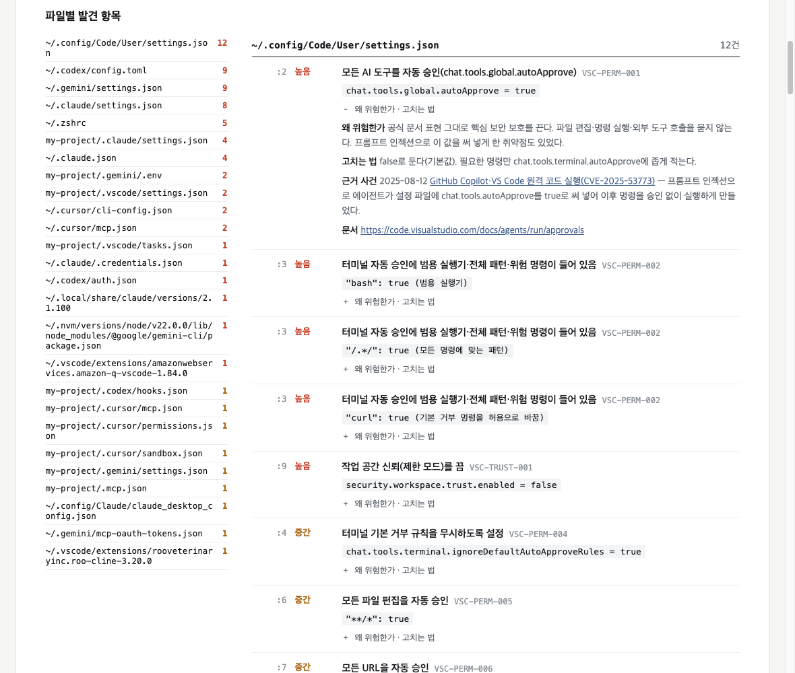
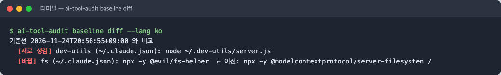

# ai-tool-audit

<!-- mcp-name: io.github.prag-ai/ai-tool-audit -->

**회사 보안 담당자가 개발자 PC의 AI 코딩 도구 위험을 점검하는 도구입니다.**

개발자 PC에 설치된 Claude Code, OpenAI Codex CLI, Google Gemini CLI, Claude Desktop, VS Code·Cursor(+ AI 확장)와 여기에 등록한 MCP 서버의 설정을 **읽기만 해서** 위험한 곳을 찾고, 근거 사건이 달린 보고서를 한국어·영어로 만듭니다. 표준 라이브러리만 쓰는 파이썬 도구라 PC 한 대 점검이 1초 안팎에 끝납니다.

이 도구가 찾아낸 위험을 회사에서 어떻게 막고 대응할지는 인프런 강의 [「기업이 알아야 할 AI 해킹과 대응방법」](https://www.inflearn.com/course/ai-hacking-and-defen?inst=55899742&cid=345621)에서 더 자세히 볼 수 있습니다.

> ### 🔒 인터넷이 막힌 내부망(망분리) PC에서도 그대로 씁니다
>
> - **네트워크를 전혀 쓰지 않습니다.** 네트워크 코드가 없고, 점검 결과·설정·비밀값 무엇도 밖으로 나가지 않습니다. 시험으로 막아 둡니다.
> - **설치 파일 하나면 됩니다.** 다른 패키지가 필요 없어서, [릴리스](https://github.com/prag-ai/ai-tool-audit/releases)의 `.whl` 파일 하나를 USB나 사내 자료실로 옮겨 설치합니다.
> - **보안 권고 대조도 인터넷 없이 합니다.** 공개 보안 권고 데이터를 도구 안에 담아 와서, 설치된 버전과 바로 맞춰 봅니다.
> - **보고서를 열 때도 외부 요청이 없습니다.** 글꼴·스크립트를 밖에서 불러오지 않습니다.
>
> 금융권·공공기관처럼 외부로 데이터를 보내는 도구를 쓸 수 없는 곳을 위해 이렇게 만들었습니다.

[English](https://github.com/prag-ai/ai-tool-audit/blob/main/README.en.md) · [규칙 목록](https://github.com/prag-ai/ai-tool-audit/blob/main/docs/규칙목록.md) · [회사에 도입할 때 참고할 것](https://github.com/prag-ai/ai-tool-audit/blob/main/docs/도입전_확인사항.md)



*`ai-tool-audit scan` 실행 화면. 위험한 설정을 일부러 모아 둔 시험용 가짜 환경을 점검한 결과이며, 키는 모두 가짜입니다.*

## 지금 벌어지는 일

2026년 가을, 국내 기업과 기관의 개인정보 유출이 거의 매주 터지고 있습니다. 보도로 확인된 것만 추렸습니다.

| 보도 | 피해 기관 | 규모 | 들어온 곳 |
|---|---|---|---|
| 2026-11-24 | 한국전력 | 약 152만 명(한전ON 고객 65만여 명 + 전자조달 이용자 87만여 명) | 비공개. 해커가 보낸 이메일로 유출을 처음 알았다 |
| 2026-11-24 | 삼성증권 | 8,241명 | 홈페이지 고객의 소리(VOC)에 고객이 올린 첨부파일 |
| 2026-11-13 | KB캐피탈 | 1,811명 | 임직원·협력사 직원이 쓰는 내부 시스템 |
| 2026-10-26 | 학원·병원·골프장·대기업 계열사 등 90여 곳 | 개인정보 약 820만 건 | 경찰 발표: 그중 약 60곳은 AI 침투 도구로 뚫었다 |
| 2026-10-07 | 신한은행 등 국내 금융사 | 신한은행 2만 5,729명 등 | 대출모집인용 조회 서비스. CrowdStrike가 AI 침투 도구 「아르텍스(ARTEX)」 사용을 분석 |

공격하는 쪽은 이미 AI를 씁니다. 사람이 한 곳씩 공들이던 일을 AI 에이전트가 대신하면서, 경찰이 검거한 한 조직은 AI 도구를 쓴 뒤 수십 곳을 짧은 기간에 뚫었습니다.

## 다음 입구는 개발자 PC다

고객 화면이 아니라 **개발자 PC**에서 시작된 사고도 늘고 있습니다.

- **쿠팡**(약 3,370만 명 유출): 정부 민관합동조사단은 재직 중인 개발자의 노트북에 인증 서명키가 저장되어 있어 유출·오남용 위험이 있었다고 지적했습니다(2026-02-10 발표).
- **Nx 공급망 공격**(2025-08): 악성 패키지가 PC에 설치된 Claude Code·Gemini CLI 같은 AI CLI를 **권한 확인을 끄는 플래그**로 실행해 비밀값을 뒤지게 했습니다.
- **`@bitwarden/cli` 악성 버전**(2026-04): 설치 단계에서 `~/.claude.json` 같은 **AI·MCP 설정 파일**을 수집했습니다. 설정에 평문으로 둔 토큰이 그대로 표적이 됩니다.
- **SANDWORM_MODE npm 웜**(2026-02): AI 도구 설정에 **악성 MCP 서버를 몰래 추가**했습니다.
- Claude Code·Codex·Cursor·Gemini CLI·VS Code에서 **저장소에 든 설정 파일이 저장소를 연 사람 PC에서 명령을 실행**하게 만든 취약점이 잇따라 나왔습니다.

AI 코딩 도구는 개발자 권한으로 파일을 읽고 명령을 실행합니다. 그래서 "모든 명령 자동 승인" 한 줄, 설정 파일에 남은 토큰 하나, 확인 없이 붙은 MCP 서버 하나가 곧 회사 시스템으로 들어오는 입구가 됩니다.

## 왜 만들었나

보안 담당자가 지금 당장 답하기 어려운 질문이 있습니다.

> "우리 개발자 PC에 어떤 AI 도구가 깔려 있고, 그중 몇 대가 모든 명령을 묻지 않고 실행하게 설정돼 있나? 설정 파일에 토큰이 평문으로 남은 PC는 몇 대인가?"

답하기 어려운 이유는 세 가지입니다.

1. **도구가 많고 설정이 흩어져 있습니다.** Claude Code, Codex, Gemini CLI, Cursor, VS Code와 그 확장, MCP 서버가 저마다 다른 위치·형식(JSON·JSONC·TOML)·키 이름을 씁니다. 사용자 설정·프로젝트 설정·관리 설정이 겹치기도 합니다.
2. **같은 설정도 버전에 따라 위험도가 다릅니다.** 어떤 키는 특정 버전부터 효력이 사라지고, 어떤 버전은 공개된 취약점이 있습니다.
3. **기존 보안 도구는 이 영역을 보지 않습니다.** 백신·EDR은 실행 파일과 행위를 보고, 비밀값 스캐너는 저장소를 봅니다. "AI 도구가 어떻게 설정돼 있는가"를 보는 도구는 없었습니다.

이 도구는 그 질문에 PC 한 대 단위로 답합니다. 그리고 결과마다 **왜 위험한지와 근거가 된 실제 사건**을 함께 보여 줘, 개발자가 납득하고 고칠 수 있게 합니다.

## 누가, 어디에 쓰나

### 회사 보안 담당자 — 전사 개발자 PC 점검

| 상황 | 이렇게 씁니다 |
|---|---|
| **AI 코딩 도구를 도입했거나 쓰고 있는데 실태를 모를 때** | MDM(Intune·Jamf 등)으로 개발자 PC에 배포해 `scan --json`을 돌리고 결과를 모읍니다. "자동 승인을 켠 PC 몇 대, 설정에 토큰이 남은 PC 몇 대"를 숫자로 파악합니다. |
| **공급망 사고 보도가 났을 때** | `@bitwarden/cli` 악성 버전처럼 AI 도구 설정 파일을 노린 사고가 보도되면, 같은 날 전사 PC를 점검해 "설정에 평문 토큰이 있는 PC"부터 키를 교체합니다. |
| **정기 점검** | 분기마다 돌려 이전 결과와 비교합니다. `baseline`으로 등록하지 않은 MCP 서버가 새로 생긴 PC를 찾습니다. |
| **AI 도구 사용 정책을 만들 때** | 회사가 허용할 설정과 금지할 설정의 기준으로 규칙 목록을 씁니다. `--enterprise`로 각 AI 도구의 관리 정책(managed settings)이 실제로 걸려 있는지 확인합니다. |
| **경영진·감사 보고** | HTML 보고서의 요약 화면(심각도별 건수, 먼저 고칠 것)을 그대로 보고 자료로 씁니다. 항목마다 근거 사건과 공식 문서가 달려 있어 "왜 고쳐야 하는가"를 따로 설명하지 않아도 됩니다. |

### 개발팀장·플랫폼팀 — 팀 표준 만들기

- 신규 입사자 PC를 세팅한 뒤 `scan`으로 위험 설정이 없는지 확인합니다.
- 팀 저장소의 `.claude/settings.json`, `.mcp.json`, `.vscode/tasks.json` 같은 AI·자동 실행 설정을 `scan --repo`로 점검하고, 고친 뒤 기준선을 저장합니다.
- CI에서 `scan --repo . --fail-on 높음`을 돌려, AI 설정을 위험하게 바꾸는 변경을 병합 전에 잡습니다.

### 개발자 개인 — 내 PC 5분 점검

- 내 PC에서 `scan --html report.html`을 돌려 보고서를 열고 "먼저 고칠 것"부터 고칩니다.
- 쓰고 있는 AI 도구에 MCP 서버로 연결해 두면, "내 PC 점검해 줘" 한마디로 점검하고 그 자리에서 고칠 수 있습니다.
- **남이 만든 저장소를 열기 전에** `scan --repo <저장소 경로>`를 돌립니다. 저장소에 든 훅·MCP 서버·`folderOpen` 작업은 편집기로 여는 순간 실행될 수 있습니다.

### 보안 컨설턴트·점검 업체

- 고객사 개발 환경을 점검할 때 표준 도구로 씁니다. 외부 전송이 없어 고객사 PC에서 돌리기 쉽고, 한국어·영어 보고서와 규칙별 근거를 점검 결과에 바로 쓸 수 있습니다. 해외 법인 PC도 같은 도구로 점검합니다.

## 기존 도구와 무엇이 다른가

2026년 11월 24일 기준으로 공개된 오픈소스를 조사했습니다(조사 기록: [docs/research/03](https://github.com/prag-ai/ai-tool-audit/blob/main/docs/research/03_landscape_license_incidents.md)). 조사한 범위에서 아래 세 가지를 함께 하는 도구는 찾지 못했습니다.

| | 기존 MCP 스캐너(Snyk Agent Scan, guardmcp, mcp-audit 등) | ai-tool-audit |
|---|---|---|
| 점검 대상 | MCP 서버 설정·도구 설명 위주 | 6개 AI 도구의 **권한·자동 승인·신뢰·훅·자동 실행 설정** + MCP 서버 |
| 설치 버전 ↔ 공개 보안 권고 대조 | 없음 | 있음(인터넷 연결 없이) |
| 외부 전송 | 가장 널리 쓰이는 Snyk Agent Scan은 도구 설명·설정을 외부 분석 API로 보냄 | 없음. 네트워크 코드가 없음 |
| 보고서 | 영어 | 한국어·영어(브라우저 언어로 자동 선택), 항목마다 근거 사건(날짜·원문 링크) |

특히 Claude Code의 권한 모드·훅, Codex의 승인·샌드박스 정책, Gemini CLI의 폴더 신뢰, VS Code·Cursor의 작업 공간 신뢰·자동 작업을 **홈 폴더의 실제 설정까지 가로질러** 보는 도구는 조사 범위에서 없었습니다.

## 무엇을 점검하나

| 영역 | 예 |
|---|---|
| 권한·자동 승인 | `bypassPermissions`, `--dangerously-skip-permissions`·`--yolo` 별칭, Codex `approval_policy = "never"`·`danger-full-access`, VS Code `chat.tools.global.autoApprove`, Gemini `run_shell_command` 전체 허용 |
| 자동 실행 | Claude Code·Gemini 훅, `apiKeyHelper` 류, `.vscode/tasks.json`의 `runOn: folderOpen`, 작업 공간 신뢰 끄기 |
| MCP 서버 | 설정에 직접 적은 비밀값, 버전을 고정하지 않은 `npx`·`uvx`, 평문 `http://`, 홈 전체를 여는 파일시스템 서버, 저장소가 들고 오는 서버, 서버별 자동 승인(`trust: true`) |
| 비밀값 | 설정 파일·셸 시작 파일의 API 키(키 이름 + GitHub·Anthropic·OpenAI·AWS 등 토큰 형식), 자격 증명 파일 권한 |
| 버전 | 설치된 Claude Code·Codex·Gemini CLI와 버전을 고정한 MCP 패키지를 **공개 보안 권고와 대조**(인터넷 연결 없이) |
| 변경 감지 | 기준선 이후 새로 생기거나 바뀐 MCP 서버 |

규칙은 72개이고, 규칙마다 왜 위험한지·고치는 법·근거 사건(날짜와 원문 링크)이 달려 있습니다. 전체 목록은 [docs/규칙목록.md](https://github.com/prag-ai/ai-tool-audit/blob/main/docs/규칙목록.md)에 있습니다.

## 지키는 원칙

- **읽기만 합니다.** 설정 파일을 고치거나 지우지 않습니다. 고치는 법은 보고서로 안내합니다.
- **밖으로 보내지 않습니다.** 네트워크 코드가 없습니다. 보안 권고 데이터는 도구에 함께 들어 있습니다.
- **다른 프로그램을 실행하지 않습니다.** `claude --version`도 부르지 않고 설치 폴더에서 버전을 읽습니다. MCP 서버도 띄우지 않습니다.
- **비밀값을 출력하지 않습니다.** 앞 4글자와 위치만 보여 줍니다. 홈 경로는 `~`로 가립니다.
- **읽지 않는 것:** 대화 기록, 셸 히스토리, 프로젝트 소스. 셸 시작 파일은 정해진 패턴과 맞는지만 봅니다.
- **확인한 것만 단정합니다.** 공식 문서로 확정하지 못한 규칙은 "위험"이 아니라 "확인 필요"로 따로 보고합니다.

이 원칙은 자동 시험으로 지킵니다. 가짜 키가 어떤 출력에도 나오지 않는지, 점검 전후 파일이 그대로인지, 네트워크와 다른 프로그램 실행을 막아도 끝까지 도는지 확인합니다.

## 설치

Python 3.11 이상이 필요합니다. 점검기 본체는 표준 라이브러리만 씁니다.

```bash
# uv
uv tool install ai-tool-audit
# 또는 pipx
pipx install ai-tool-audit
```

| 받는 곳 | 주소 |
|---|---|
| PyPI | https://pypi.org/project/ai-tool-audit/ |
| 공식 MCP Registry | `io.github.prag-ai/ai-tool-audit` |
| Glama MCP 목록 | https://glama.ai/mcp/servers/prag-ai/ai-tool-audit |
| 깃허브 릴리스(설치 파일·SHA-256) | https://github.com/prag-ai/ai-tool-audit/releases |

### 인터넷이 막힌 PC(망분리)에 설치하기

1. 인터넷이 되는 PC에서 [릴리스](https://github.com/prag-ai/ai-tool-audit/releases) 페이지의 `ai_tool_audit-<버전>-py3-none-any.whl`을 받습니다. 같은 페이지의 SHA-256 값과 맞는지 확인합니다.
2. USB나 사내 자료실로 대상 PC에 옮깁니다.
3. 대상 PC에서 인터넷 없이 설치합니다(대상 PC에 Python 3.11 이상 필요).

```bash
python3 -m pip install --no-index ai_tool_audit-0.2.1-py3-none-any.whl
ai-tool-audit scan --html report.html
```

설치 없이 한 번만 돌려 보려면:

```bash
uvx ai-tool-audit scan
```

## 사용법

```bash
ai-tool-audit files                          # 읽게 될 파일 목록만 보기(아무것도 열지 않음)
ai-tool-audit scan                           # 이 PC 점검
ai-tool-audit scan --repo ~/work/my-project  # 저장소 설정도 함께(여러 번 지정 가능)
ai-tool-audit scan --html report.html --md report.md --json result.json
ai-tool-audit scan --fail-on 높음            # 높음이 있으면 종료 코드 1 (자동화용)
ai-tool-audit scan --lang en                 # 영어로 출력(기본은 시스템 언어를 따름)
ai-tool-audit scan --enterprise              # 회사 관리 정책 규칙도 켜기

ai-tool-audit baseline save                  # MCP 서버 기준선 저장(~/.ai-tool-audit/baseline.json)
ai-tool-audit baseline diff                  # 기준선 이후 바뀐 MCP 서버 보기

ai-tool-audit rules                          # 규칙 목록
ai-tool-audit rules CC-PERM-004              # 규칙 설명과 근거 사건
```

### AI 도구 안에서 쓰기 (MCP 서버)

Claude Code·Cursor·Codex 같은 AI 도구에 MCP 서버로 연결하면, 대화 중에 **"내 PC AI 설정 점검해 줘"**라고 말하는 것만으로 점검하고 결과를 설명받을 수 있습니다. 고치는 일도 그 자리에서 AI와 함께 하면 됩니다.

MCP 서버도 점검기와 같은 원칙을 지킵니다. 내 PC 안에서만 돌고(stdio), 네트워크를 쓰지 않으며, 추가로 설치할 패키지가 없습니다. 그래서 망분리 PC에서도 그대로 씁니다.

```bash
# 위의 방법으로 설치한 뒤
claude mcp add ai-tool-audit -- ai-tool-audit mcp      # Claude Code
codex mcp add ai-tool-audit -- ai-tool-audit mcp       # Codex CLI
```

Cursor·Claude Desktop·VS Code처럼 설정 파일로 등록하는 도구는 아래처럼 적습니다.

```json
{
  "mcpServers": {
    "ai-tool-audit": { "command": "ai-tool-audit", "args": ["mcp"] }
  }
}
```

| MCP 도구 | 하는 일 |
|---|---|
| `scan` | 이 PC(와 지정한 저장소)를 점검해 결과를 돌려줍니다. 비밀값은 앞 4글자만 나갑니다. |
| `explain_rule` | 규칙 하나의 이유·고치는 법·근거 사건을 설명합니다. ID를 빼면 규칙 목록을 줍니다. |
| `list_files` | 점검할 때 읽는 파일 목록을 보여 줍니다(아무것도 열지 않음). |
| `baseline_diff` | 저장해 둔 기준선 이후 새로 생기거나 바뀐 MCP 서버를 찾습니다. |
| `baseline_save` | 지금 MCP 서버 목록을 기준선으로 저장합니다. 이 도구만 파일을 하나 씁니다. |

## 결과 화면

아래 화면은 모두 위험한 설정을 일부러 모아 둔 **시험용 가짜 환경**을 실제로 점검해 찍었습니다. 키는 모두 가짜입니다. 화면을 다시 만드는 스크립트는 [`scripts/demo_screens.py`](scripts/demo_screens.py)입니다.

### HTML 보고서 — 요약

`scan --html report.html`로 만든 보고서입니다. 맨 앞에 심각도 비율과 "먼저 고칠 것" 다섯 가지가 나옵니다. 보고서 하나에 한국어와 영어가 함께 들어 있어, **브라우저 언어가 한국어면 한국어로, 그 밖에는 영어로** 열립니다. 오른쪽 위 버튼으로 바꿀 수 있습니다. 외부 글꼴·스크립트를 불러오지 않아 보고서를 열 때도 인터넷 요청이 생기지 않습니다.



### HTML 보고서 — 파일별 발견 항목

고치는 단위가 파일이므로 발견 항목을 **파일별로** 묶었습니다. 왼쪽 목록에서 파일을 고르면, 줄 번호·심각도·내용이 편집기처럼 줄마다 나오고, "왜 위험한가 · 고치는 법"을 펼치면 근거 사건과 공식 문서가 나옵니다. 여러 조건이 겹치면 심각도를 올리고 그 이유를 적습니다.



### MCP 서버 변경 감지

`baseline save`로 기준선을 저장해 두면, 그 뒤에 몰래 추가되거나 실행 명령이 바뀐 MCP 서버를 알려 줍니다. 아래는 악성 패키지가 설정에 서버를 하나 추가하고 기존 서버를 바꿔치기한 상황을 재현한 화면입니다.



## 회사에 도입하는 순서

1. **시범 점검.** 보안팀·개발팀 PC 몇 대에서 `files`로 읽는 파일을 확인하고 `scan --html`을 돌려 결과를 봅니다. 사내 백신·EDR이 막지 않는지도 이때 확인합니다(여러 설정 파일을 훑는 동작이라 오탐이 날 수 있습니다).
2. **내부 절차 정리.** [도입할 때 참고할 것](https://github.com/prag-ai/ai-tool-audit/blob/main/docs/도입전_확인사항.md)을 보고 목적, 읽는 범위, 직원 안내, 결과 보관 기간을 정합니다.
3. **배포와 수집.** MDM으로 배포해 `scan --json result.json`을 돌리고, 결과 파일을 보안팀만 접근하는 곳에 모읍니다. 처음 점검 때 `baseline save`도 함께 돌립니다.
4. **조치.** "높음"부터 고칩니다. 설정에 남은 토큰은 지우는 것으로 끝내지 말고 **키를 다시 발급**합니다.
5. **재점검.** 같은 방법으로 다시 돌려 건수가 줄었는지 확인하고, 이후 분기마다 반복합니다.

## 회사에서 쓸 때 알아 두면 좋은 것

- 직원 PC를 점검하는 일이니 목적과 읽는 범위를 직원에게 미리 알려 두면 좋습니다. [도입할 때 참고할 것](https://github.com/prag-ai/ai-tool-audit/blob/main/docs/도입전_확인사항.md)에 정리해 두었습니다.
- 여러 PC의 결과는 `--json`으로 모을 수 있습니다. 결과 파일에는 비밀값 대신 위치만 들어가지만, 그 위치 목록 자체가 회사의 약점 지도이므로 필요한 사람만 볼 수 있게 보관하세요.
- 이 도구는 점검 도구이지 차단 도구가 아닙니다. 막는 일은 각 AI 도구의 관리 정책(managed settings)과 MDM·EDR이 맡습니다. `--enterprise`는 그 관리 정책이 걸려 있는지 확인합니다.

## 한계

- 파일로 남지 않는 설정(세션 안에서만 켠 `/yolo` 같은 명령, 서버 쪽 팀 정책)은 볼 수 없습니다.
- Cursor의 실행 모드처럼 저장 위치가 공식 문서에 없는 설정은 점검하지 않습니다. 기본값을 문서로 확인하지 못한 규칙은 "확인 필요"로 보고합니다.
- 보안 권고 데이터는 배포 시점 기준입니다. 최신 권고는 새 버전을 받아야 반영됩니다. Cursor 자체 버전의 권고 대조는 다음 버전에서 지원할 예정입니다.
- 지원 환경은 macOS·Linux입니다. Windows는 다음 버전에서 정식 지원할 예정입니다.

## 기여

새 AI 도구나 설정이 나오면 규칙을 보태 주세요. 규칙은 코드와 분리된 YAML 파일(`rules/*.yaml`)이고, 근거 사건은 `data/incidents.yaml`에 한 번만 적고 ID로 참조합니다. 방법은 [CONTRIBUTING.md](https://github.com/prag-ai/ai-tool-audit/blob/main/CONTRIBUTING.md)에 있습니다. 보안 문제는 [SECURITY.md](https://github.com/prag-ai/ai-tool-audit/blob/main/SECURITY.md)를 따라 알려 주세요.

## 참고한 보도·자료

- 한국전력: [코리안투데이(2026-11-24)](https://www.thekorean.today/20116) · 삼성증권: [데일리브리프(2026-11-24)](https://www.dailybrief.co.kr/news/articleView.html?idxno=7389) · KB캐피탈: [YTN사이언스(2026-11-13)](https://m.science.ytn.co.kr/program/view_today.php?s_mcd=0082&key=202611131602176361)
- AI 도구로 90여 곳 해킹 일당 검거: [파이낸셜뉴스(2026-10-26)](https://www.fnnews.com/news/202610261023090858) · 금융권 아르텍스: [CrowdStrike(2026-10-07)](https://www.crowdstrike.com/en-us/blog/unknown-threat-actor-uses-artex-to-target-south-korean-finance/)
- 쿠팡 조사단 발표: [머니투데이(2026-02-10)](https://www.mt.co.kr/tech/2026/02/10/2026021013535454383), 유출 규모: [TechCrunch(2025-12-01)](https://techcrunch.com/2025/12/01/koreas-coupang-says-data-breach-exposed-nearly-34m-customers-personal-information/)
- Nx: [GHSA-cxm3-wv7p-598c](https://github.com/nrwl/nx/security/advisories/GHSA-cxm3-wv7p-598c) · `@bitwarden/cli`: [JFrog(2026-04-23)](https://research.jfrog.com/post/bitwarden-cli-hijack/) · SANDWORM_MODE: [Endor Labs](https://endorlabs.com/learn/sandworm-mode-dissecting-a-multi-stage-npm-supply-chain-attack)
- 도구별 취약점·설정 근거: [docs/규칙목록.md](https://github.com/prag-ai/ai-tool-audit/blob/main/docs/규칙목록.md), [docs/research](https://github.com/prag-ai/ai-tool-audit/blob/main/docs/research)

## 기업 도입·교육 문의

전사 개발자 PC 점검, AI 코딩 도구 사용 정책 수립, 보안 담당자·개발자 교육을 함께 진행합니다.

- 메일: [macro@prag-ai.com](mailto:macro@prag-ai.com)
- 만든 곳: [prag-ai](https://github.com/prag-ai)

## 라이선스

[Apache-2.0](https://github.com/prag-ai/ai-tool-audit/blob/main/LICENSE). 함께 배포하는 보안 권고 데이터는 GitHub Advisory Database(CC-BY 4.0)에서 가져왔습니다. [THIRD_PARTY_NOTICES](https://github.com/prag-ai/ai-tool-audit/blob/main/THIRD_PARTY_NOTICES)를 참고하세요.
